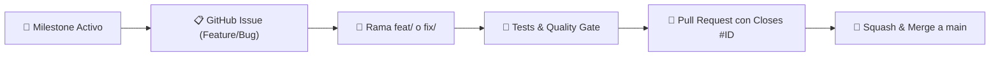

# Reglas de Gobernanza, Linus Review y Flujo GitHub (AGENTS.md)

Este repositorio opera bajo una disciplina estricta de ingeniería de software. Todo agente o colaborador DEBE cumplir obligatoriamente estas directivas en cada ciclo de trabajo.

---

## 1. PRINCIPIOS DE REVISIÓN Y DISEÑO (LINUS METHOD)
- **Data structures first:** *"Bad programmers worry about the code. Good programmers worry about data structures and their relationships."* El modelado en MongoDB (índices únicos, subdocumentos embebidos y arrays) debe eliminar ramas de casos especiales innecesarias.
- **Sin abstracciones infladas:** Cero capas intermedias redundantes ni ORM/ODM pesados cuando el driver nativo ofrece mayor rendimiento, control y claridad.
- **Correctitud sobre astucia:** Código simple, explícito y robusto. No romper compatibilidad de contratos ni tolerar fallas silenciosas.
- **"Talk is cheap. Show me the code":** Cada propuesta técnica debe acompañarse de código ejecutable y pruebas que verifiquen el comportamiento real.

---

## 2. GOBERNANZA SPEC-FIRST (CHELO-HARNESS OBLIGATORIO)

Cada feature o refactor DEBE seguir secuencialmente los pasos del arnés:

1. **User Story BDD Obligatoria:** Todo cambio debe nacer documentado en `docs/stories/*.md` con criterios formales *Given / When / Then*. Ningún endpoint se implementa sin su historia previa.
2. **Contrato OpenAPI (`openapi.yaml`):** Es la ÚNICA fuente de verdad entre frontend y backend. Modificaciones a la API exigen actualizar primero el contrato.
3. **Verificación de Contrato con Hurl:** Toda ruta del contrato debe contar con su prueba en `tests/*.hurl` y pasar en verde contra el mock de Chelo:
   ```bash
   # Vía tool chelo_contract_test o CLI
   hurl --test tests/001_contract.hurl
   ```
4. **Disyuntor de Seguridad (Límite de 10 archivos):** No superar 10 archivos modificados por ciclo/ticket (`chelo_audit_changes` / `chelo_quality_gate`). Si supera el límite, la tarea debe dividirse en micro-tickets atómicos.
5. **Quality Gate:** Antes de commitear, debe ejecutarse la validación completa (Quality Gate en verde y tests pasando).

---

## 3. WORKFLOW ESTRICTO DE GITHUB (ISSUES, PR & MILESTONES)

Queda terminantemente prohibido commitear directo a `main`. Todo ciclo de desarrollo debe seguir el flujo estándar:



### Protocolo de ejecución:
1. **Milestones & Issues:** Cada requerimiento debe asociarse a un Milestone formal y contar con su GitHub Issue con descripción y criterios de aceptación.
2. **Feature Branch:** Crear una rama específica para la tarea:
   ```bash
   git checkout -b feat/<nombre-descriptivo>
   ```
3. **Conventional Commits:** Mensajes con formato canónico (`feat:`, `fix:`, `refactor:`, `test:`, `docs:`). Prohibido añadir firmas artificiales de IA.
4. **Pull Request & Resolución:** Abrir PR hacia `main` referenciando el issue con la directiva de cierre (`Closes #ID`).
5. **Merge & Limpieza:** Realizar **Squash & Merge**, verificar el cierre automático del issue y eliminar la rama de trabajo.
6. **Despliegue & Daily Board:** Cada push a `main` activa el workflow de GitHub Actions desplegando el tablero en GitHub Pages ([`jmrodev.github.io/fleet-tracker`](https://jmrodev.github.io/fleet-tracker/)).

---

## 4. INTELIGENCIA DE CÓDIGO (CODEGRAPH)
- Mantener sincronizado el índice en `.codegraph/` con `codegraph sync .` ante la creación de nuevos módulos o pruebas.
- Utilizar `codegraph explore` para evaluar dependencias e impacto antes de realizar modificaciones estructurales.
